<link rel="stylesheet" href="/blog_posts/experiments/philosophy-notes/philosophy-post.css">

  

  <h1>Philosophy Timeline: Understanding the Human Mind</h1>
  
I'm fascinated by philosophy, psychology and the study of the human mind: what we do, and why we do it. This timeline follows 25 thinkers across 2,500 years, from Socrates to Martha Nussbaum.

  <nav class="ph-jump" aria-label="On this page">
    <a href="#when-did-the-great-philosophers-live">Timeline</a>
    <a href="#what-drives-human-behavior-six-answers-from-2500-years">Six answers</a>
    <a href="#the-philosophers-one-by-one">All 25 thinkers</a>
    <a href="#quiz-who-thought-this">Quiz</a>
    <a href="/blog_posts/whatwedowhywedo.html">Read the essay →</a>
  </nav>



> **In short:** Many great philosophical traditions took shape between the 6th and 4th centuries BCE, with Confucius in China, the Buddha in India and Socrates, Plato and Aristotle in Greece. This timeline follows 25 thinkers through six eras to today, each with dates, school and a one-line answer to why humans do what they do.

## When did the great philosophers live?

<figure class="hv" data-hv="lifespans">

Figure: the lifespans of 25 philosophers as bars on a time axis from 600 BCE to today, with a break between 450 CE and 1100 CE. Ancient: Confucius 551–479 BCE, the Buddha c. 563–483 BCE (traditional dates), Socrates c. 470–399 BCE, Plato c. 428–348 BCE, Aristotle 384–322 BCE, Augustine 354–430 CE. Medieval: Ibn Rushd 1126–1198, Thomas Aquinas 1225–1274. Early modern: Descartes 1596–1650, Spinoza 1632–1677, Locke 1632–1704, Hume 1711–1776, Kant 1724–1804. 19th century: Hegel 1770–1831, Kierkegaard 1813–1855, Marx 1818–1883, Nietzsche 1844–1900. 20th century: Freud 1856–1939, Wittgenstein 1889–1951, Heidegger 1889–1976, Sartre 1905–1980, de Beauvoir 1908–1986, Foucault 1926–1984. Contemporary: Dennett 1942–2024, Nussbaum born 1947.

<figcaption><strong>Two bursts, one long gap.</strong> Each bar is one life; hover or tap for dates, click to jump to the card. The axis is broken between 450 and 1100 CE, a stretch this list skips. Ancient dates are approximate.</figcaption>
</figure>

Read more: the six eras at a glance

The 25 thinkers on this page fall into six eras. The list is personal, not a complete canon: it follows the thinkers who shaped how I think about human behavior.

| Era | Years | Key figures | Central theme |
|---|---|---|---|
| Ancient | 6th century BCE to 6th century CE | Socrates, Plato, Aristotle, Confucius, the Buddha, Augustine | Foundations of human inquiry: virtue, knowledge, suffering, love |
| Medieval | 5th to 15th century | Thomas Aquinas, Ibn Rushd (Averroes) | Synthesis of faith and reason |
| Renaissance and early modern | 15th to 18th century | Descartes, Spinoza, Locke, Hume, Kant | Rationalism versus empiricism; foundations of modern thought |
| 19th century | 1800 to 1900 | Hegel, Kierkegaard, Marx, Nietzsche | Individual existence, social conditions, will to power |
| 20th century | 1900 to 2000 | Freud, Wittgenstein, Heidegger, Sartre, de Beauvoir, Foucault | The unconscious, existentialism, language, power |
| Contemporary | 2000 to present | Daniel Dennett, Martha Nussbaum | Consciousness, capabilities, emotions |

Some lives overlap in surprising ways. Spinoza and Locke were both born in 1632. Wittgenstein and Heidegger were both born in 1889, a few months apart. Confucius, the Buddha (on the traditional dates) and Socrates' early years fall within roughly a century of each other, in China, India and Greece.

The Buddha's dates are uncertain. The traditional dates are c. 563–483 BCE; many scholars now place his life later, around 480–400 BCE. The chart uses the traditional dates.

## What drives human behavior? Six answers from 2,500 years

<figure class="hv" data-hv="drivers">

Figure: the 25 philosophers grouped by their answer to "why do we do what we do?". Reason and knowledge: Socrates, Ibn Rushd, Thomas Aquinas, Descartes, Kant. Desire and emotion: the Buddha, Augustine, Spinoza, Hume, Nussbaum. Virtue, habit and upbringing: Confucius, Aristotle, Locke. Inner drives: Plato, Nietzsche, Freud, Dennett. Society, history and power: Hegel, Marx, Wittgenstein, de Beauvoir, Foucault. Freedom and anxiety: Kierkegaard, Heidegger, Sartre.

<figcaption><strong>The same question, six kinds of answer.</strong> Pick an answer to see who gave it, then tap a face to read their card. The grouping is my own reading of each thinker's one-line answer below.</figcaption>
</figure>

Read more: how the six answers differ

Every thinker on this timeline answers the question "why do we do what we do?" differently, but the answers cluster into six families. This grouping is my interpretation, based on the one-line summaries in the cards below; most philosophers touch several families.

1. **Reason and knowledge** (Socrates, Ibn Rushd, Aquinas, Descartes, Kant): we act on what we know or believe to be right, so bad action comes from ignorance, unclear thinking or failing to follow reason and duty.
2. **Desire and emotion** (the Buddha, Augustine, Spinoza, Hume, Nussbaum): feeling comes first. Hume put it most sharply: we act more from passion and habit than from reason.
3. **Virtue, habit and upbringing** (Confucius, Aristotle, Locke): character is built by practice, ritual, relationships and education, so better habits and environments make better people.
4. **Inner drives** (Plato, Nietzsche, Freud, Dennett): forces inside us that we don't fully see, from Plato's divided soul to Freud's unconscious to Dennett's competing neural narratives.
5. **Society, history and power** (Hegel, Marx, Wittgenstein, de Beauvoir, Foucault): we are shaped by the historical moment, economic conditions, language and the power structures we absorb.
6. **Freedom and anxiety** (Kierkegaard, Heidegger, Sartre): we are free and that freedom frightens us, so much of what we do is an escape from it.

## The philosophers, one by one

  <label class="ph-search">Search philosophers<input type="search" id="ph-q" placeholder="Search a name, school or idea…" autocomplete="off"></label>
  

  

<section class="ph-era" id="era-ancient" data-era="ancient" markdown="0">
<h3 class="ph-era-title">Ancient philosophy <small>6th century BCE to 6th century CE</small></h3>
<article class="ph-card" id="socrates" data-name="Socrates" data-born="-470" data-died="-399" data-era="ancient" data-driver="reason" data-school="Classical Greek">
  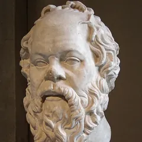
  

    <h4 class="ph-name">Socrates</h4>
    
c. 470–399 BCE Classical Greek

    
“The unexamined life is not worth living” (as reported in Plato’s <em>Apology</em>). Pioneered the method of questioning to understand human nature and ethics.

    
<strong>Why we do what we do:</strong> People act wrongly due to ignorance; if we truly know what is good, we will do good.

    <a class="ph-essay" href="/blog_posts/whatwedowhywedo.html#ancient-philosophy">In the essay: why we do what we do →</a>
  

</article>
<article class="ph-card" id="plato" data-name="Plato" data-born="-428" data-died="-348" data-era="ancient" data-driver="drives" data-school="Classical Greek">
  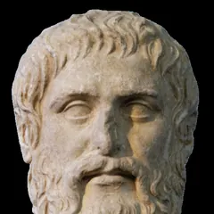
  

    <h4 class="ph-name">Plato</h4>
    
c. 428–348 BCE Classical Greek

    
Explored the nature of reality, knowledge, and the ideal state. Created the theory of Forms and examined the soul’s structure.

    
<strong>Why we do what we do:</strong> Human behavior stems from the conflict between reason, spirit, and appetite within the soul.

    <a class="ph-essay" href="/blog_posts/whatwedowhywedo.html#ancient-philosophy">In the essay: why we do what we do →</a>
  

</article>
<article class="ph-card" id="aristotle" data-name="Aristotle" data-born="-384" data-died="-322" data-era="ancient" data-driver="habit" data-school="Classical Greek">
  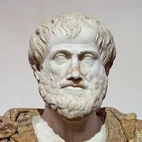
  

    <h4 class="ph-name">Aristotle</h4>
    
384–322 BCE Classical Greek

    
Systematized logic, ethics, and politics. Studied human flourishing (<em>eudaimonia</em>) and virtue ethics.

    
<strong>Why we do what we do:</strong> We act to achieve happiness through virtue, which is developed through habit and practice.

    <a class="ph-essay" href="/blog_posts/whatwedowhywedo.html#ancient-philosophy">In the essay: why we do what we do →</a>
  

</article>
<article class="ph-card" id="confucius" data-name="Confucius" data-born="-551" data-died="-479" data-era="ancient" data-driver="habit" data-school="Chinese Philosophy">
  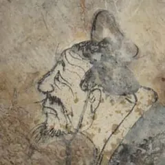
  

    <h4 class="ph-name">Confucius</h4>
    
551–479 BCE Chinese Philosophy

    
Emphasized moral cultivation, social harmony, and the importance of relationships and ritual.

    
<strong>Why we do what we do:</strong> Human behavior should be guided by virtue, respect for others, and social responsibility.

  

</article>
<article class="ph-card" id="the-buddha" data-name="Buddha (Siddhartha Gautama)" data-born="-563" data-died="-483" data-era="ancient" data-driver="emotion" data-school="Buddhist Philosophy">
  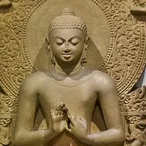
  

    <h4 class="ph-name">Buddha (Siddhartha Gautama)</h4>
    
c. 563–483 BCE (traditional) Buddhist Philosophy

    
Explored suffering, desire, and the path to enlightenment through understanding the mind. Many scholars now place his life later, around 480–400 BCE.

    
<strong>Why we do what we do:</strong> We act from attachment and desire, which causes suffering; liberation comes through mindfulness.

  

</article>
<article class="ph-card" id="augustine-of-hippo" data-name="Augustine of Hippo" data-born="354" data-died="430" data-era="ancient" data-driver="emotion" data-school="Christian Philosophy">
  
  

    <h4 class="ph-name">Augustine of Hippo</h4>
    
354–430 CE Christian Philosophy

    
Integrated Christian theology with philosophy, exploring free will, time, and human nature.

    
<strong>Why we do what we do:</strong> Human actions are driven by love: either love of God (good) or love of self (sin).

    <a class="ph-essay" href="/blog_posts/whatwedowhywedo.html#medieval-insights">In the essay: why we do what we do →</a>
  

</article>
</section>
<section class="ph-era" id="era-medieval" data-era="medieval" markdown="0">
<h3 class="ph-era-title">Medieval philosophy <small>5th to 15th century</small></h3>
<article class="ph-card" id="averroes" data-name="Ibn Rushd (Averroes)" data-born="1126" data-died="1198" data-era="medieval" data-driver="reason" data-school="Islamic Philosophy">
  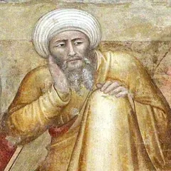
  

    <h4 class="ph-name">Ibn Rushd (Averroes)</h4>
    
1126–1198 Islamic Philosophy

    
Defended philosophy against religious orthodoxy, emphasizing reason and individual thought.

    
<strong>Why we do what we do:</strong> Human behavior should be guided by reason, which can lead to truth and happiness.

  

</article>
<article class="ph-card" id="thomas-aquinas" data-name="Thomas Aquinas" data-born="1225" data-died="1274" data-era="medieval" data-driver="reason" data-school="Scholasticism">
  
  

    <h4 class="ph-name">Thomas Aquinas</h4>
    
1225–1274 Scholasticism

    
Synthesized Aristotelian philosophy with Christian doctrine, exploring reason and faith.

    
<strong>Why we do what we do:</strong> We act according to our nature, seeking the ultimate good (God) through reason and virtue.

    <a class="ph-essay" href="/blog_posts/whatwedowhywedo.html#medieval-insights">In the essay: why we do what we do →</a>
  

</article>
</section>
<section class="ph-era" id="era-early-modern" data-era="early-modern" markdown="0">
<h3 class="ph-era-title">Renaissance and early modern <small>15th to 18th century</small></h3>
<article class="ph-card" id="rene-descartes" data-name="René Descartes" data-born="1596" data-died="1650" data-era="early-modern" data-driver="reason" data-school="Rationalism">
  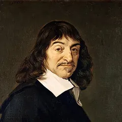
  

    <h4 class="ph-name">René Descartes</h4>
    
1596–1650 Rationalism

    
“I think, therefore I am.” Established the foundation of modern philosophy through methodical doubt.

    
<strong>Why we do what we do:</strong> We act based on clear and distinct ideas; error comes from hasty judgment and unclear thinking.

    <a class="ph-essay" href="/blog_posts/whatwedowhywedo.html#enlightenment-reason">In the essay: why we do what we do →</a>
  

</article>
<article class="ph-card" id="baruch-spinoza" data-name="Baruch Spinoza" data-born="1632" data-died="1677" data-era="early-modern" data-driver="emotion" data-school="Rationalism">
  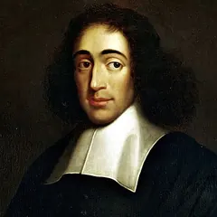
  

    <h4 class="ph-name">Baruch Spinoza</h4>
    
1632–1677 Rationalism

    
Developed a deterministic view of reality where everything follows natural laws, including human emotions.

    
<strong>Why we do what we do:</strong> We are driven by emotions and desires; freedom comes from understanding our nature and emotions.

  

</article>
<article class="ph-card" id="john-locke" data-name="John Locke" data-born="1632" data-died="1704" data-era="early-modern" data-driver="habit" data-school="Empiricism">
  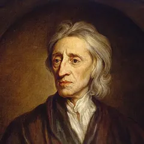
  

    <h4 class="ph-name">John Locke</h4>
    
1632–1704 Empiricism

    
Argued that knowledge comes from experience; the mind is a “blank slate” shaped by sensory input.

    
<strong>Why we do what we do:</strong> Our behavior is shaped by experience and education; we can be improved through better environments.

  

</article>
<article class="ph-card" id="david-hume" data-name="David Hume" data-born="1711" data-died="1776" data-era="early-modern" data-driver="emotion" data-school="Empiricism">
  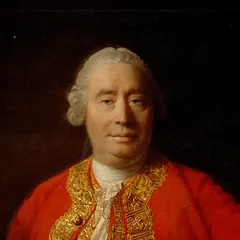
  

    <h4 class="ph-name">David Hume</h4>
    
1711–1776 Empiricism

    
Skeptical about reason’s power; emphasized the role of habit, custom, and sentiment in human nature.

    
<strong>Why we do what we do:</strong> We act more from passion and habit than reason; moral judgments come from feelings, not logic.

    <a class="ph-essay" href="/blog_posts/whatwedowhywedo.html#enlightenment-reason">In the essay: why we do what we do →</a>
  

</article>
<article class="ph-card" id="immanuel-kant" data-name="Immanuel Kant" data-born="1724" data-died="1804" data-era="early-modern" data-driver="reason" data-school="German Idealism">
  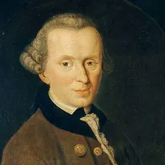
  

    <h4 class="ph-name">Immanuel Kant</h4>
    
1724–1804 German Idealism

    
Synthesized rationalism and empiricism; developed the categorical imperative for moral action.

    
<strong>Why we do what we do:</strong> We should act from duty and universal moral laws, not just desire or consequence.

    <a class="ph-essay" href="/blog_posts/whatwedowhywedo.html#enlightenment-reason">In the essay: why we do what we do →</a>
  

</article>
</section>
<section class="ph-era" id="era-19th-century" data-era="19th-century" markdown="0">
<h3 class="ph-era-title">19th-century philosophy <small>1800 to 1900</small></h3>
<article class="ph-card" id="georg-wilhelm-friedrich-hegel" data-name="Georg Wilhelm Friedrich Hegel" data-born="1770" data-died="1831" data-era="19th-century" data-driver="society" data-school="German Idealism">
  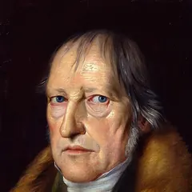
  

    <h4 class="ph-name">Georg Wilhelm Friedrich Hegel</h4>
    
1770–1831 German Idealism

    
Developed the dialectical method; saw history as the progressive unfolding of absolute spirit.

    
<strong>Why we do what we do:</strong> We act within historical contexts; consciousness develops through conflict and resolution.

  

</article>
<article class="ph-card" id="soren-kierkegaard" data-name="Søren Kierkegaard" data-born="1813" data-died="1855" data-era="19th-century" data-driver="freedom" data-school="Existentialism">
  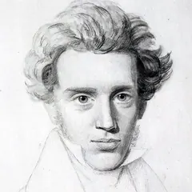
  

    <h4 class="ph-name">Søren Kierkegaard</h4>
    
1813–1855 Existentialism

    
Emphasized individual existence, choice, and the leap of faith; critiqued systematic philosophy.

    
<strong>Why we do what we do:</strong> We act from anxiety about our freedom; authentic existence requires passionate commitment.

    <a class="ph-essay" href="/blog_posts/whatwedowhywedo.html#19th-century">In the essay: why we do what we do →</a>
  

</article>
<article class="ph-card" id="karl-marx" data-name="Karl Marx" data-born="1818" data-died="1883" data-era="19th-century" data-driver="society" data-school="Historical Materialism">
  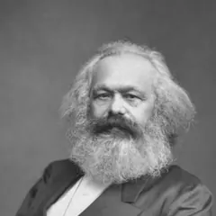
  

    <h4 class="ph-name">Karl Marx</h4>
    
1818–1883 Historical Materialism

    
Analyzed capitalism and class struggle; argued that material conditions shape consciousness.

    
<strong>Why we do what we do:</strong> Our actions are determined by economic and social conditions; consciousness follows material reality.

    <a class="ph-essay" href="/blog_posts/whatwedowhywedo.html#19th-century">In the essay: why we do what we do →</a>
  

</article>
<article class="ph-card" id="friedrich-nietzsche" data-name="Friedrich Nietzsche" data-born="1844" data-died="1900" data-era="19th-century" data-driver="drives" data-school="Existentialism">
  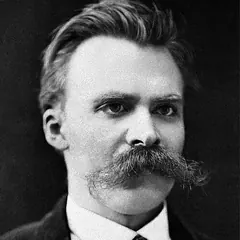
  

    <h4 class="ph-name">Friedrich Nietzsche</h4>
    
1844–1900 Existentialism

    
“God is dead.” Challenged traditional morality and advocated for creating one’s own values.

    
<strong>Why we do what we do:</strong> We act from will to power; we must create our own meaning in a meaningless universe.

    <a class="ph-essay" href="/blog_posts/whatwedowhywedo.html#19th-century">In the essay: why we do what we do →</a>
  

</article>
</section>
<section class="ph-era" id="era-20th-century" data-era="20th-century" markdown="0">
<h3 class="ph-era-title">20th-century philosophy <small>1900 to 2000</small></h3>
<article class="ph-card" id="sigmund-freud" data-name="Sigmund Freud" data-born="1856" data-died="1939" data-era="20th-century" data-driver="drives" data-school="Psychoanalysis">
  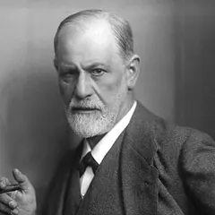
  

    <h4 class="ph-name">Sigmund Freud</h4>
    
1856–1939 Psychoanalysis

    
Explored the unconscious mind, revealing hidden motivations behind human behavior.

    
<strong>Why we do what we do:</strong> Much of our behavior is driven by unconscious desires, fears, and childhood experiences.

  

</article>
<article class="ph-card" id="ludwig-wittgenstein" data-name="Ludwig Wittgenstein" data-born="1889" data-died="1951" data-era="20th-century" data-driver="society" data-school="Analytic Philosophy">
  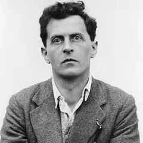
  

    <h4 class="ph-name">Ludwig Wittgenstein</h4>
    
1889–1951 Analytic Philosophy

    
“The limits of my language mean the limits of my world.” Explored language and its role in thought.

    
<strong>Why we do what we do:</strong> Our actions are shaped by language games and forms of life that give meaning to our words.

  

</article>
<article class="ph-card" id="martin-heidegger" data-name="Martin Heidegger" data-born="1889" data-died="1976" data-era="20th-century" data-driver="freedom" data-school="Existentialism">
  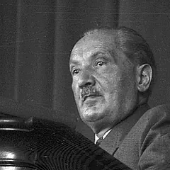
  

    <h4 class="ph-name">Martin Heidegger</h4>
    
1889–1976 Existentialism

    
Explored the question of Being; emphasized authenticity and being-toward-death.

    
<strong>Why we do what we do:</strong> We act to flee from anxiety about our mortality; authentic existence requires facing this anxiety.

  

</article>
<article class="ph-card" id="jean-paul-sartre" data-name="Jean-Paul Sartre" data-born="1905" data-died="1980" data-era="20th-century" data-driver="freedom" data-school="Existentialism">
  
  

    <h4 class="ph-name">Jean-Paul Sartre</h4>
    
1905–1980 Existentialism

    
“Existence precedes essence.” We are condemned to be free and must create our own meaning.

    
<strong>Why we do what we do:</strong> We act to escape the overwhelming responsibility of absolute freedom, often in bad faith.

    <a class="ph-essay" href="/blog_posts/whatwedowhywedo.html#20th-century">In the essay: why we do what we do →</a>
  

</article>
<article class="ph-card" id="simone-de-beauvoir" data-name="Simone de Beauvoir" data-born="1908" data-died="1986" data-era="20th-century" data-driver="society" data-school="Feminist Existentialism">
  
  

    <h4 class="ph-name">Simone de Beauvoir</h4>
    
1908–1986 Feminist Existentialism

    
“One is not born, but rather becomes, a woman.” Examined how social conditioning shapes identity.

    
<strong>Why we do what we do:</strong> Our behavior is heavily influenced by social expectations and power structures we internalize.

    <a class="ph-essay" href="/blog_posts/whatwedowhywedo.html#20th-century">In the essay: why we do what we do →</a>
  

</article>
<article class="ph-card" id="michel-foucault" data-name="Michel Foucault" data-born="1926" data-died="1984" data-era="20th-century" data-driver="society" data-school="Post-Structuralism">
  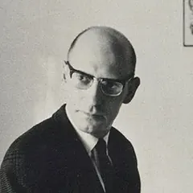
  

    <h4 class="ph-name">Michel Foucault</h4>
    
1926–1984 Post-Structuralism

    
Analyzed how power shapes knowledge, identity, and behavior through institutions and discourse.

    
<strong>Why we do what we do:</strong> Our actions are shaped by invisible power structures operating through knowledge systems.

  

</article>
</section>
<section class="ph-era" id="era-contemporary" data-era="contemporary" markdown="0">
<h3 class="ph-era-title">Contemporary philosophy <small>2000 to present</small></h3>
<article class="ph-card" id="daniel-dennett" data-name="Daniel Dennett" data-born="1942" data-died="2024" data-era="contemporary" data-driver="drives" data-school="Philosophy of Mind">
  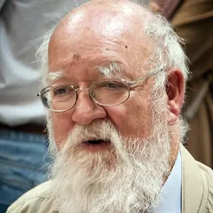
  

    <h4 class="ph-name">Daniel Dennett</h4>
    
1942–2024 Philosophy of Mind

    
Applied evolutionary and computational approaches to consciousness and free will.

    
<strong>Why we do what we do:</strong> Our behavior emerges from complex neural processes; consciousness is multiple competing narratives.

  

</article>
<article class="ph-card" id="martha-nussbaum" data-name="Martha Nussbaum" data-born="1947" data-died="" data-era="contemporary" data-driver="emotion" data-school="Capabilities Approach">
  
  

    <h4 class="ph-name">Martha Nussbaum</h4>
    
born 1947 Capabilities Approach

    
Bridges ancient philosophy with contemporary issues, emphasizing human capabilities and emotions.

    
<strong>Why we do what we do:</strong> We act to develop our human capabilities; emotions play a crucial role in moral reasoning.

  

</article>
</section>

## Quiz: who thought this?

<figure class="hv" data-hv="quiz">

Quiz: the page shows one philosopher's answer to "why do we do what we do?" and four portraits; pick the thinker who gave it. For example, "We act more from passion and habit than reason" is David Hume, and "We act from will to power" is Friedrich Nietzsche. The quiz needs JavaScript; every answer is in the cards above.

<figcaption><strong>Ten rounds, four faces each.</strong> Every answer comes from the cards above, so a wrong guess is a good excuse to read one.</figcaption>
</figure>

## Timeless questions about human nature

<ul class="ph-questions" markdown="0">
  <li>What drives human behavior: reason, emotion, or something else?</li>
  <li>Are we fundamentally good, evil, or neutral?</li>
  <li>How much of our behavior is determined, and how much is free?</li>
  <li>What role do social structures play in shaping who we are?</li>
  <li>How has our understanding of consciousness evolved?</li>
  <li>What can ancient wisdom teach us about modern psychology?</li>
</ul>

## My research notes

**Featured: [Why Do We Do What We Do? A Philosophical Journey Across the Ages](/blog_posts/whatwedowhywedo.html).** I wrote a longer exploration of human motivation through the lens of philosophy, tracing how thinkers from ancient Greece to modern neuroscience have answered this question. It connects the insights on this timeline with modern psychology and neuroscience.

Research connections I still want to explore:

- How Buddhist mindfulness relates to modern cognitive therapy
- Connections between Stoic philosophy and resilience research
- Aristotelian virtue ethics and positive psychology
- Existentialist anxiety and the modern understanding of mental health
- Foucault's power analysis and social psychology
- Ancient debates about free will and neuroscience findings

*AI credit: this exploration was developed with help from AI research assistants. They helped synthesize and phrase ideas; the perspectives and critical analysis are my own.*



## Portrait credits

Read more: where the 25 portraits come from

All portraits come from Wikimedia Commons and are either in the public domain or under a Creative Commons license. I cropped and resized them; Creative Commons BY-SA images remain under the same license. Portraits of ancient thinkers are later artistic depictions, not likenesses.

- **Socrates**: Copy of Lysippos (?), [Wikimedia Commons](https://commons.wikimedia.org/wiki/File:Socrates_Louvre.jpg), Public domain.
- **Plato**: Marie-Lan Nguyen, [Wikimedia Commons](https://commons.wikimedia.org/wiki/File:Plato_Silanion_Musei_Capitolini_MC1377.png), Public domain.
- **Aristotle**: After Lysippos, [Wikimedia Commons](https://commons.wikimedia.org/wiki/File:Aristotle_Altemps_Inv8575.jpg), Public domain.
- **Confucius**: Anonymous Chinese painter of the Western Han period, [Wikimedia Commons](https://commons.wikimedia.org/wiki/File:Confucius,_fresco_from_a_Western_Han_tomb_of_Dongping_County,_Shandong_province,_China_(cropped).jpg), Public domain.
- **Buddha (Siddhartha Gautama)**: พระมหาเทวประภาส วชิรญาณเมธี, [Wikimedia Commons](https://commons.wikimedia.org/wiki/File:Buddha_in_Sarnath_Museum_(Dhammajak_Mutra).jpg), CC BY-SA 3.0 ([license](https://creativecommons.org/licenses/by-sa/3.0)).
- **Augustine of Hippo**: Philippe de Champaigne, [Wikimedia Commons](https://commons.wikimedia.org/wiki/File:Saint_Augustine_by_Philippe_de_Champaigne.jpg), Public domain.
- **Ibn Rushd (Averroes)**: Sailko, [Wikimedia Commons](https://commons.wikimedia.org/wiki/File:Andrea_di_bonaiuto,_apoteosi_di_san_tommaso_d%27aquino,_11_averro%C3%A8.jpg), CC BY 3.0 ([license](https://creativecommons.org/licenses/by/3.0)).
- **Thomas Aquinas**: Carlo Crivelli, [Wikimedia Commons](https://commons.wikimedia.org/wiki/File:St-thomas-aquinasFXD.jpg), Public domain.
- **René Descartes**: After Frans Hals, [Wikimedia Commons](https://commons.wikimedia.org/wiki/File:Frans_Hals_-_Portret_van_Ren%C3%A9_Descartes.jpg), Public domain.
- **Baruch Spinoza**: anonymous, [Wikimedia Commons](https://commons.wikimedia.org/wiki/File:Spinoza.jpg), Public domain.
- **John Locke**: Godfrey Kneller, [Wikimedia Commons](https://commons.wikimedia.org/wiki/File:Godfrey_Kneller_-_Portrait_of_John_Locke_(Hermitage).jpg), Public domain.
- **David Hume**: Allan Ramsay, [Wikimedia Commons](https://commons.wikimedia.org/wiki/File:David_Hume_Ramsay.jpg), Public domain.
- **Immanuel Kant**: Johann Gottlieb Becker (1720-1782), [Wikimedia Commons](https://commons.wikimedia.org/wiki/File:Immanuel_Kant_-_Gemaelde_1.jpg), Public domain.
- **Georg Wilhelm Friedrich Hegel**: Jakob Schlesinger, [Wikimedia Commons](https://commons.wikimedia.org/wiki/File:Jakob_Schlesinger_-_Hegel_1831.jpg), Public domain.
- **Søren Kierkegaard**: La Biblioteca Real de Dinamarca, [Wikimedia Commons](https://commons.wikimedia.org/wiki/File:S%C3%B8ren_Kierkegaard_(1813-1855)_-_(cropped).jpg), Public domain.
- **Karl Marx**: John Jabez Edwin Mayall, [Wikimedia Commons](https://commons.wikimedia.org/wiki/File:Karl_Marx_by_John_Jabez_Edwin_Mayall_1875_-_Restored.png), Public domain.
- **Friedrich Nietzsche**: Friedrich Hermann Hartmann, [Wikimedia Commons](https://commons.wikimedia.org/wiki/File:Nietzsche187a.jpg), Public domain.
- **Sigmund Freud**: Max Halberstadt, [Wikimedia Commons](https://commons.wikimedia.org/wiki/File:Sigmund_Freud,_by_Max_Halberstadt_(cropped).jpg), Public domain.
- **Ludwig Wittgenstein**: Moritz Nähr, [Wikimedia Commons](https://commons.wikimedia.org/wiki/File:Ludwig_Wittgenstein_1929.jpg), Public domain.
- **Martin Heidegger**: Willy Pragher, [Wikimedia Commons](https://commons.wikimedia.org/wiki/File:Freiburg,_Z%C3%A4hringen-_Jahnhalle,_Prof._Martin_Heidegger_w%C3%A4hrend_eines_Vortrags_-_LABW_-_Staatsarchiv_Freiburg_W_134_Nr._023740f_(cropped).jpeg), CC BY 4.0 ([license](https://creativecommons.org/licenses/by/4.0)).
- **Jean-Paul Sartre**: Unknown author, [Wikimedia Commons](https://commons.wikimedia.org/wiki/File:Jean_Paul_Sartre_1965.jpg), CC BY-SA 3.0 nl ([license](https://creativecommons.org/licenses/by-sa/3.0/nl/deed.en)).
- **Simone de Beauvoir**: Moshe Milner, [Wikimedia Commons](https://commons.wikimedia.org/wiki/File:Simone_De_Beauvoir_(cropped).jpg), CC BY-SA 3.0 ([license](https://creativecommons.org/licenses/by-sa/3.0)).
- **Michel Foucault**: Jerry Bauer, [Wikimedia Commons](https://commons.wikimedia.org/wiki/File:Photo_of_Michel_Foucault_on_1970_dustjacket_of_The_Order_of_Things.jpg), Public domain.
- **Daniel Dennett**: Dmitry Rozhkov, [Wikimedia Commons](https://commons.wikimedia.org/wiki/File:Daniel_Dennett_2.jpg), CC BY-SA 3.0 ([license](https://creativecommons.org/licenses/by-sa/3.0)).
- **Martha Nussbaum**: Sally Ryan, [Wikimedia Commons](https://commons.wikimedia.org/wiki/File:Martha_Nussbaum_2010_(cropped).jpg), CC BY-SA 3.0 ([license](https://creativecommons.org/licenses/by-sa/3.0)).

