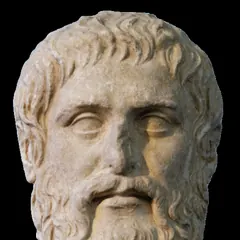
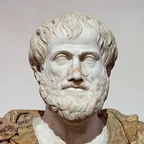
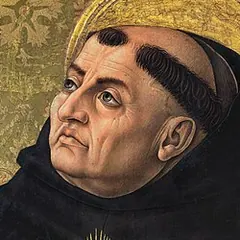
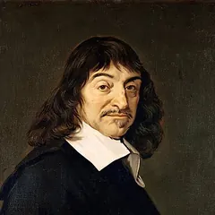
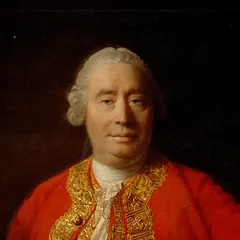
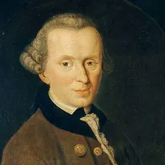
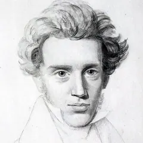
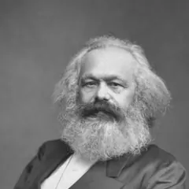
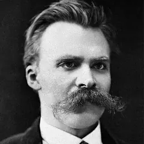
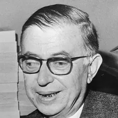

<link rel="stylesheet" href="/blog_posts/experiments/philosophy-notes/philosophy-post.css">

  

    
    
    
    
    
    
    
    
    
    
    
    
  

  <h1>Why Do We Do What We Do?</h1>
  
A philosophical journey across the ages, from Plato's charioteer to cognitive science, and what it means for my own morning coffee, code and friendships.



> **In short:** Philosophers have explained human action as the pursuit of a perceived good (Plato, Aristotle, the Stoics), love directed toward an ultimate end (Augustine, Aquinas), passion served by reason (Hume), duty (Kant), will to power (Nietzsche), material conditions (Marx), radical freedom (Sartre) and, in cognitive science, partly unconscious processes.

*I often catch myself wondering what really drives my actions. Is it desire, duty, survival, love, or something deeper? This simple question, "Why do we do what we do?", has followed humanity through the ages. Each era's thinkers held up a mirror to human motives. In this journey I reflect on how different schools of thought have grappled with the engines of human action, and what their insights mean for us today. Faces link to each thinker's card on the [philosophy timeline](/blog_posts/philosophy-notes.html).*

## Seven eras, seven answers

<figure class="hv" data-hv="journey" markdown="0">

Figure: the answer to "why do we do what we do?" in each era. Ancient (6th century BCE to 6th century CE): we act for a perceived good; reason must rule desire. Medieval (5th to 15th century): love is the weight that moves us toward an ultimate end. Enlightenment (17th to 18th century): passions drive us (Hume), but moral action should come from duty (Kant). 19th century: will to power (Nietzsche), material conditions (Marx), the individual's chosen meaning (Kierkegaard). 20th century: we are condemned to be free (Sartre); what works (pragmatism); reasons as causes (analytic philosophy). Contemporary: much of it happens below awareness, and we can still revise our wants. Personal: all of the above, in my morning coffee.

<figcaption><strong>Each era moved the answer somewhere new:</strong> from the good, to love, to passion and duty, to power and society, to freedom, to the brain. Tap a step to jump to that section.</figcaption>
</figure>

## Ancient philosophy: reason, desire and the good {#ancient-philosophy}

6th century BCE to 6th century CE · <a href="/blog_posts/philosophy-notes.html#era-ancient">see these thinkers on the timeline →</a>

  <a href="/blog_posts/philosophy-notes.html#plato" data-era="ancient">Plato</a>
  <a href="/blog_posts/philosophy-notes.html#aristotle" data-era="ancient">Aristotle</a>
  <i aria-hidden="true">S</i>The Stoics

<blockquote class="ess-quote" markdown="0">
  
Every art and every inquiry, and similarly every action and pursuit, is thought to aim at some good.

  <cite>Aristotle, <em>Nicomachean Ethics</em>, Book I (W. D. Ross translation)</cite>
</blockquote>

<ul class="ess-keys" markdown="0" data-era="ancient">
  <li><strong>We aim at a perceived good.</strong> Even bad actions stem from a mistaken view of what is good.</li>
  <li><strong>Reason versus desire.</strong> Plato's reason against appetite, or Stoic judgment against passion, is the inner dynamic that directs what we do.</li>
  <li><strong>Virtue is reason in charge.</strong> For Aristotle and the Stoics, acting in line with reason and nature leads to genuine happiness.</li>
</ul>

Read more: Plato's charioteer, Aristotle's ends, and the Stoics

In ancient Greece, philosophers began our story by rooting human action in a search for the **good**. [Plato](/blog_posts/philosophy-notes.html#plato) traced human behavior to three sources: desire, emotion (spirit) and knowledge (reason). In the *Republic* he described the soul as tripartite, and in the *Phaedrus* he pictured it as a charioteer of reason struggling to rein in two horses: a noble, spirited one and an unruly one of appetite. (The often-shared line "Human behavior flows from three main sources: desire, emotion, and knowledge" summarizes this view but does not appear in Plato's dialogues.)

Why do we do what we do, according to Plato? Because our soul's parts push and pull us: our **desires** draw us toward what seems good, our **emotions** spur us or hold us back, and our **reason** seeks a higher understanding of the true Good. If reason rules, we act wisely; if appetite or anger takes over, we might stray. Plato believed no one *knowingly* does wrong; we err out of ignorance, mistaking what is truly good. This optimistic view implies that if we *know* the Good, we will do it. Knowledge, in this sense, is motivation.

[Aristotle](/blog_posts/philosophy-notes.html#aristotle) took up a similar theme but added nuance. For Aristotle, every action aims at some *end* or *purpose*, and ultimately at **happiness (eudaimonia)**. *"Every art and every inquiry, and similarly every action and pursuit, is thought to aim at some good,"* he wrote at the opening of the *Nicomachean Ethics*, meaning we always act for the sake of something we perceive as good. If you go to work, maybe it's for money (a proximate end), which in turn is for security or pleasure, all leading toward the ultimate end of well-being or fulfillment.

Aristotle grounded this in a natural teleology: just as a seed acts to become a tree, a person acts to achieve flourishing. We do what we do *because* we seek our *"proper good,"* whether we realize it or not. He also argued that **habits** shape our character: we become just by doing just acts. (The famous line *"we are what we repeatedly do"* is Will Durant's 1926 summary of this idea, not Aristotle's own words.) This hints that virtuous actions, repeated, spring from a trained motivation to be excellent.

Meanwhile, the **Stoics** offered a more stern answer to the question of action. They agreed that humans are rational beings and claimed that a *life according to nature* (aligned with reason and virtue) is the ultimate purpose of action. A Stoic might say that *why* a wise person acts is straightforward: to exercise virtue, the only true good.

The Stoics understood the motivations behind human actions in terms of **assent** to impressions: we experience desires and aversions, but it is our judgment that assents (or not) to acting on them. Wrong actions, they thought, come from faulty judgment rather than malice. *"They do wrong through ignorance and unintentionally,"* wrote the Stoic emperor Marcus Aurelius (<em>Meditations</em> 7.22), sounding much like [Socrates](/blog_posts/philosophy-notes.html#socrates).

## Medieval insights: will, love and divine purpose {#medieval-insights}

5th to 15th century · <a href="/blog_posts/philosophy-notes.html#era-medieval">see these thinkers on the timeline →</a>

  <a href="/blog_posts/philosophy-notes.html#augustine-of-hippo" data-era="ancient">Augustine</a>
  <a href="/blog_posts/philosophy-notes.html#thomas-aquinas" data-era="medieval">Aquinas</a>

<blockquote class="ess-quote" markdown="0">
  
My weight, is my love; thereby am I borne, whithersoever I am borne.

  <cite>Augustine, <em>Confessions</em>, Book XIII (E. B. Pusey translation)</cite>
</blockquote>

<ul class="ess-keys" markdown="0" data-era="medieval">
  <li><strong>Love orders actions.</strong> What we love decides what we do: disordered loves lead to bad actions, rightly ordered love to righteous ones.</li>
  <li><strong>Every action has an ultimate end.</strong> Medieval thinkers agree with antiquity that all acts aim at a final good, ultimately union with the divine.</li>
  <li><strong>Free will needs help.</strong> We are free to choose, but the will needs illumination and grace; motive is personal and spiritual, not mechanical.</li>
</ul>

Read more: Augustine's weight of love and Aquinas's ultimate end

As philosophy moved into the medieval era, the question of human motivation took on a theological flavor. Thinkers like Saint Augustine and Saint Thomas Aquinas blended classical ideas with Christian doctrine, asking not just *why* we act, but how our actions relate to God's plan and our ultimate salvation.

For [Augustine](/blog_posts/philosophy-notes.html#augustine-of-hippo), the restless heart of human motivation is **love**. In his view, *what* you love defines *why* you act: *"pondus meum amor meus"*, "my weight is my love", he writes; *by it I am carried wherever I go*. This beautiful metaphor suggests that love is the gravity of the soul. Why do we do what we do? Because we are pulled by the weight of our affections.

Augustine saw the whole drama of life as a conflict between love of God and love of worldly things. If we love God (the highest good), our actions will tend toward charity and virtue. If we let disordered loves (for power, pleasure, self) rule us, we will act wrongly. In stories like his famous youthful theft of pears, Augustine analyzed his own motive and found it stemmed from a perverse thrill in doing wrong: a misdirection of love.

[Aquinas](/blog_posts/philosophy-notes.html#thomas-aquinas), writing later in the High Middle Ages, systematized the question of motivation under his grand synthesis of Christian theology with Aristotelian philosophy. He echoes Aristotle: *"Every agent acts for an end,"* and for human beings that ultimate end is **beatitudo**, the blessed happiness of union with God.

## Enlightenment and reason: the rise of the rational self {#enlightenment-reason}

17th to 18th century · <a href="/blog_posts/philosophy-notes.html#era-early-modern">see these thinkers on the timeline →</a>

  <a href="/blog_posts/philosophy-notes.html#rene-descartes" data-era="early-modern">Descartes</a>
  <a href="/blog_posts/philosophy-notes.html#david-hume" data-era="early-modern">Hume</a>
  <a href="/blog_posts/philosophy-notes.html#immanuel-kant" data-era="early-modern">Kant</a>

<blockquote class="ess-quote" markdown="0">
  
Reason is, and ought only to be the slave of the passions, and can never pretend to any other office than to serve and obey them.

  <cite>David Hume, <em>A Treatise of Human Nature</em>, Book II (1739–40)</cite>
</blockquote>

<ul class="ess-keys" markdown="0" data-era="early-modern">
  <li><strong>Passion versus reason.</strong> Hume set one extreme: emotion drives everything. Kant set the other: reason <em>ought</em> to drive moral action.</li>
  <li><strong>The individual will emerges.</strong> Descartes and Kant stressed the autonomy of the thinking self: we can deliberately choose why we act.</li>
  <li><strong>Natural explanations.</strong> Thinkers began to look for the causes of action in human nature rather than only in divine will.</li>
</ul>

Read more: Descartes, Hume and Kant on what moves us

The Enlightenment of the 17th and 18th centuries shifted focus toward human **reason** and the individual mind. Philosophers in this era asked: are we fundamentally rational actors, or driven by passion? As scientific thinking rose, explanations of behavior began to look for *natural* (not just supernatural) causes.

[Descartes](/blog_posts/philosophy-notes.html#rene-descartes), a 17th-century rationalist, straddled old and new. Famously, he said *"I think, therefore I am,"* putting consciousness at the center of human identity. Descartes was intrigued by how the **passions** (emotions and desires) move us, yet he believed reason was meant to hold the reins.

Then comes [David Hume](/blog_posts/philosophy-notes.html#david-hume), the great empiricist, who turned Descartes' view upside down. Hume boldly claimed that *reason alone is not the motive for any action*. Instead, passions are the engine of all our deeds; without them we would lack any motivation at all. In his *Treatise of Human Nature* (1739–40) he put it bluntly: *"Reason is, and ought only to be the slave of the passions."*

[Kant](/blog_posts/philosophy-notes.html#immanuel-kant), coming in at the end of the 18th century, tried to rescue the power of reason at least in the moral realm. He drew a line between **inclinations** (our desires and emotions) and **duty** (the moral law dictated by reason). He answered our question on two levels: for ordinary choices, yes, we often act from self-interest or desire; but for *moral* actions, the only valid motive is **good will**.

## 19th century: will, power and social drives {#19th-century}

1800 to 1900 · <a href="/blog_posts/philosophy-notes.html#era-19th-century">see these thinkers on the timeline →</a>

  <a href="/blog_posts/philosophy-notes.html#soren-kierkegaard" data-era="19th-century">Kierkegaard</a>
  <a href="/blog_posts/philosophy-notes.html#karl-marx" data-era="19th-century">Marx</a>
  <a href="/blog_posts/philosophy-notes.html#friedrich-nietzsche" data-era="19th-century">Nietzsche</a>

  
<b>Nietzsche</b>Will to power: every living thing strives to expand and assert itself.

  
<b>Marx</b>Material conditions: economics and class shape what people do.

  
<b>Kierkegaard</b>Inner meaning: aesthetic, ethical and religious stages of life.

<ul class="ess-keys" markdown="0" data-era="19th-century">
  <li><strong>Underlying drives.</strong> Forces like the will to power sit beneath conscious motives, often unseen.</li>
  <li><strong>Socio-economic motives.</strong> Behavior is not in a vacuum: class, labor and economic need shape our goals.</li>
  <li><strong>Individual authenticity.</strong> With Kierkegaard, the motives that matter are those aligned with one's chosen values or faith.</li>
</ul>

Read more: Nietzsche, Marx and Kierkegaard

The 19th century saw an explosion of new ideas about human motivation, influenced by the tumult of the industrial age, political revolutions and scientific advances. Philosophers during this era, figures like Friedrich Nietzsche, Karl Marx and Søren Kierkegaard, broke with many past assumptions.

Enter [Nietzsche](/blog_posts/philosophy-notes.html#friedrich-nietzsche), who put forward one of the most provocative answers: behind all human actions lies the **will to power**. For Nietzsche, *every* living thing, whether it realizes it or not, strives to expand its power, to assert itself. He argued that this will to power offers a deeper explanation of human behavior than earlier theories that focused on survival or happiness.

On a very different front, [Karl Marx](/blog_posts/philosophy-notes.html#karl-marx) approached human behavior through the lens of **material conditions and class**. Marx relocated the "why" of human actions from individual minds to the structure of society. In his view, the broad patterns of what people do (especially in groups) are driven by economic forces and relations of production.

Meanwhile, [Kierkegaard](/blog_posts/philosophy-notes.html#soren-kierkegaard) in Denmark delved into the *inner* dimension of motivation, arguably starting existentialist thought. He didn't look to power or economics, but to the individual's **relationship with meaning, self and God**. Kierkegaard spoke of different "stages of life", the **aesthetic**, **ethical** and **religious**, each with its own answer to why we act.

## 20th-century currents: freedom, pragmatism and analysis {#20th-century}

1900 to 2000 · <a href="/blog_posts/philosophy-notes.html#era-20th-century">see these thinkers on the timeline →</a>

  <a href="/blog_posts/philosophy-notes.html#jean-paul-sartre" data-era="20th-century">Sartre</a>
  <a href="/blog_posts/philosophy-notes.html#simone-de-beauvoir" data-era="20th-century">de Beauvoir</a>
  <i aria-hidden="true">AC</i>Camus
  <i aria-hidden="true">WJ</i>William James

<blockquote class="ess-quote" markdown="0">
  
Man is condemned to be free.

  <cite>Jean-Paul Sartre, <em>Existentialism Is a Humanism</em> (1946)</cite>
</blockquote>

  
<b>Existentialism</b>No preset reason to act: we must choose one, and own it.

  
<b>Pragmatism</b>We do what works: habits and practical consequences.

  
<b>Analytic philosophy</b>What does it mean to act for a reason?

Read more: existentialists, pragmatists and analytic philosophers

The 20th century, marked by world wars, rapid scientific progress and global ideological clashes, brought yet new angles. Three broad movements in philosophy tackled our question in different ways: **existentialism** (focused on individual freedom and meaning), **pragmatism** (focused on practical consequences and habits), and **analytic philosophy** (focused on language, logic and the mechanics of mind).

The **existentialists** (like [Jean-Paul Sartre](/blog_posts/philosophy-notes.html#jean-paul-sartre), [Simone de Beauvoir](/blog_posts/philosophy-notes.html#simone-de-beauvoir) and Albert Camus) inherited Kierkegaard's torch of personal authenticity but usually without a theistic framework. For them, human beings are condemned to **freedom**: there is no preset answer to why we must act, so we have to choose it for ourselves.

Switch to **pragmatism**, an American-born philosophy with figures like William James and John Dewey. Pragmatists were less concerned with metaphysical ultimates and more with **what works** in human life. They effectively answer "why do we do what we do?" with **because it is useful or makes a difference to us**.

Finally, the **analytic philosophers** of the 20th century took a more fine-grained approach, dissecting the language and logic of how we explain actions. They asked not so much "What ultimate force drives action?" but "What does it *mean* to have a reason or motive? How do reasons explain actions?"

- **Radical freedom and responsibility:** existentialists assert that ultimately *we* give our lives motives and meaning. Even in absurd conditions, we can choose our reason for acting.
- **Practical and empirical turn:** pragmatists and psychologists focus on *how* our motives operate in real life, through habits, conditioned responses and practical decision-making.
- **Analytic clarity:** the fine dissection of action shows the interplay of belief, desire and intention. Asking "why" can mean seeking a person's reasoning.

## Contemporary views: mind sciences and philosophical psychology {#contemporary-views}

2000 to present · <a href="/blog_posts/philosophy-notes.html#era-contemporary">see contemporary thinkers on the timeline →</a>

  
<b>What I say I want</b>conscious reasons, second-order desires

  
<b>What I feel</b>emotions, rewards (dopamine), fear (amygdala)

  
<b>What runs on its own</b>habits, heuristics, implicit biases

<ul class="ess-keys" markdown="0" data-era="contemporary">
  <li><strong>Interdisciplinary answers.</strong> Neuroscience, psychology and philosophy combine for a fuller picture.</li>
  <li><strong>Awareness lets us revise.</strong> Mindfulness, therapy and reflection help us notice <em>why</em> we act and change harmful patterns.</li>
  <li><strong>The will is still a mystery.</strong> The debate over free will remains open: how much choice do we really have?</li>
</ul>

Read more: the unconscious, the brain and Frankfurt's higher-order desires

Standing in the 21st century, we have a more interdisciplinary understanding of human behavior than ever before. **Cognitive science**, **neuroscience** and **evolutionary psychology** provide vast data on *how* and *why* humans (and other animals) act. Contemporary philosophers often engage with these findings, creating a field one might call *philosophical psychology*, or philosophy of mind in action.

One significant contemporary insight is the role of the **unconscious**. Research strongly suggests that a lot of our decision-making happens *below the surface* of conscious reasoning. For instance, psychologists have documented phenomena like implicit biases (attitudes that affect our actions without our awareness) and heuristics (mental shortcuts that operate automatically). In Benjamin Libet's 1983 experiments, brain activity linked to a simple movement began a few hundred milliseconds before people reported deciding to move; what that means for free will is still debated.

**Neuroscience** adds another layer, connecting motivations to brain regions and chemicals. Dopamine pathways are involved in reward and thus in motivating seeking behavior. The amygdala can trigger fight-or-flight actions out of fear. Some researchers have proposed that "mirror neurons" help explain empathy, though that idea remains contested.

**Philosophical psychology** today often focuses on concepts like **intention, agency and identity**. For instance, Harry Frankfurt's theory of persons (1971) distinguishes between first-order desires (simple wants) and second-order desires (wants about our wants). His idea was that what we *truly* want, and thus what we act on when we are being our genuine selves, is determined by these higher-order volitions.

## What does it mean for me? Stay curious and stay alive {#personal-reflection}

<figure class="hv" data-hv="lens" markdown="0">

Figure: one everyday action, explained through different philosophers' lenses (my own illustrative reading of each view).

<dl data-action="Making my morning coffee">
<dt data-who="aristotle">Aristotle</dt><dd>A habit repeated until it became part of me; a small daily ritual is how character forms.</dd>
<dt data-who="david-hume">Hume</dt><dd>Desire comes first: I want caffeine. Reason only works out how to boil the water.</dd>
<dt data-who="william-james">William James</dt><dd>Habit saves effort: once a routine is grooved in, it runs almost without deciding.</dd>
<dt data-who="science">Cognitive science</dt><dd>An automatic routine that starts before any deliberate choice; I notice it once it is underway.</dd>
</dl>
<dl data-action="Helping a friend">
<dt data-who="david-hume">Hume</dt><dd>Sympathy: I feel a share of their trouble, and the feeling moves me.</dd>
<dt data-who="aristotle">Aristotle</dt><dd>Humans are social; friendship is part of a flourishing life, not a detour from it.</dd>
<dt data-who="harry-frankfurt">Frankfurt</dt><dd>A second-order desire: I want to be someone who wants to help.</dd>
<dt data-who="immanuel-kant">Kant</dt><dd>Kind, but it has full moral worth only if I would help from duty even when I didn't feel like it.</dd>
</dl>
<dl data-action="Losing hours to a hard coding problem">
<dt data-who="aristotle">Aristotle</dt><dd>All humans by nature desire to know; the puzzle is its own reward.</dd>
<dt data-who="friedrich-nietzsche">Nietzsche</dt><dd>Will to power: the joy is in overcoming resistance and growing stronger.</dd>
<dt data-who="plato">Plato</dt><dd>Reason, the charioteer, enjoying the ride toward understanding.</dd>
<dt data-who="karl-marx">Marx</dt><dd>It is also labor, shaped by a tech career and the economy around it.</dd>
</dl>
<dl data-action="Writing clean code instead of a quick hack">
<dt data-who="immanuel-kant">Kant</dt><dd>Duty: do it right because it is right, not because anyone is checking.</dd>
<dt data-who="aristotle">Aristotle</dt><dd>Do it often enough and it stops being a rule and becomes who I am.</dd>
<dt data-who="stoics">The Stoics</dt><dd>The impulse says ship it now; judgment can withhold assent from that impulse.</dd>
<dt data-who="jean-paul-sartre">Sartre</dt><dd>In choosing for myself, I also choose an image of what a programmer should be.</dd>
</dl>
<dl data-action="Overthinking a small decision">
<dt data-who="soren-kierkegaard">Kierkegaard</dt><dd>Anxiety is the dizziness of freedom: too many possibilities at once.</dd>
<dt data-who="jean-paul-sartre">Sartre</dt><dd>No rule decides for me, so even small choices carry the weight of freedom.</dd>
<dt data-who="stoics">The Stoics</dt><dd>It is not the decision that troubles me but my judgment about it; that part is in my control.</dd>
</dl>

<figcaption><strong>Same action, different "why".</strong> Pick an everyday action to see how each thinker might explain it. These are my illustrative readings of their views, not their own words.</figcaption>
</figure>

When I think about why *I* do what I do in light of all this, I see fascinating layers in my daily actions. I make coffee each morning, not just because I'm habitually craving caffeine (pragmatic habit, physiological drive), but also because the ritual itself brings a meditative start to my day. The simple act of boiling water and mixing my black coffee, stripped of any unnecessary complexity, becomes a moment of clarity and focus, perhaps reflecting a broader philosophical preference for essence over ornament.

I find myself drawn to helping friends and colleagues, partly because I empathize (emotional intuition) and because I've adopted a value that meaningful connections matter (second-order endorsement). But there's also a deeper satisfaction in being part of a supportive community, perhaps touching on what Aristotle called the social nature of human flourishing. This extends to my approach to learning and problem-solving. I immerse myself in coding challenges and complex problems not just for practical skill-building, but because there's a profound joy in the intellectual pursuit itself (a blend of Nietzsche's will to power and Aristotle's natural human curiosity).

My eclectic taste in [music](/blog_posts/music.html), spanning different genres and languages, reflects both a desire for aesthetic pleasure and a deeper yearning to connect with diverse human experiences. Whether it's classical, jazz, or folk music from across the globe, each genre offers a unique lens into human expression and emotion. And yes, I often find myself overthinking small decisions or interactions, a tendency that can be both a curse and a blessing. It's the philosopher's burden: to seek meaning even in mundane moments, though sometimes this very seeking can overshadow the simple joy of being.

Yet, I also use reasoning to discern what is true and good, and that rational motive can override others. A touch of Kantian duty pushes me to write clean, maintainable code rather than quick hacks, or to give honest feedback instead of just pleasing others. All this occurs while navigating the practical demands of a tech career (Marx's material dimension) and the influence of modern digital culture.

**This multifaceted nature of my motivations is both humbling and empowering.** Humbling because it shows how many factors, from caffeine cravings to cultural conditioning, influence my daily choices. I can't claim to be purely rational in my decisions. Empowering because understanding these various drives gives me a chance to align them better with my values and growth. As the ancient oracle advised, "Know thyself": whether in code, coffee, or conversation, that remains a lifetime's journey.

<a href="/blog_posts/philosophy-notes.html#quiz-who-thought-this">Test yourself: take the 10-round “who thought this?” quiz on the timeline →</a>



## Sources and further reading

Primary texts:

- Aristotle, *Nicomachean Ethics* ([Project Gutenberg](https://www.gutenberg.org/ebooks/8438)): every action aims at some good; virtue formed by habit.
- Augustine, *Confessions* ([Project Gutenberg, Pusey translation](https://www.gutenberg.org/ebooks/3296)): "My weight, is my love" (Book XIII).
- David Hume, *A Treatise of Human Nature* ([Project Gutenberg](https://www.gutenberg.org/ebooks/4705)): "Reason is, and ought only to be the slave of the passions" (Book II, Part III, Section III).

Overviews from the Stanford Encyclopedia of Philosophy:

- [Plato's ethics](https://plato.stanford.edu/entries/plato-ethics/) (the tripartite soul), [Aristotle's ethics](https://plato.stanford.edu/entries/aristotle-ethics/), [Stoicism](https://plato.stanford.edu/entries/stoicism/) (assent to impressions)
- [Augustine](https://plato.stanford.edu/entries/augustine/), [Aquinas](https://plato.stanford.edu/entries/aquinas/) (every agent acts for an end)
- [Descartes' ethics](https://plato.stanford.edu/entries/descartes-ethics/) (the passions), [Hume's moral philosophy](https://plato.stanford.edu/entries/hume-moral/), [Kant's moral philosophy](https://plato.stanford.edu/entries/kant-moral/) (duty and good will)
- [Nietzsche](https://plato.stanford.edu/entries/nietzsche/) (will to power), [Marx](https://plato.stanford.edu/entries/marx/) (material conditions), [Kierkegaard](https://plato.stanford.edu/entries/kierkegaard/) (stages of life)
- [Sartre](https://plato.stanford.edu/entries/sartre/) (freedom and responsibility), [Camus](https://plato.stanford.edu/entries/camus/) (the happy Sisyphus), [William James](https://plato.stanford.edu/entries/james/) (habit and pragmatism)
- [Action](https://plato.stanford.edu/entries/action/) (Anscombe and Davidson on reasons as explanations) and [free will](https://plato.stanford.edu/entries/freewill/) (Frankfurt; Libet's findings)

